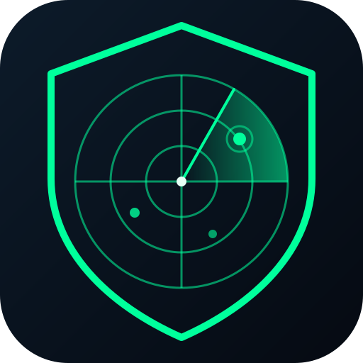

<p align="center">
  
</p>

<h1 align="center">HawkScan</h1>

<p align="center">
  Lightweight multithreaded TCP port scanner with banner grabbing, written in pure Python.
</p>

<p align="center">
  
  
  
</p>

---

## About

HawkScan is an educational network reconnaissance tool inspired by Nmap. It performs a full TCP connect scan using only the Python standard library, classifies ports as `open`, `closed` or `filtered`, identifies common services and grabs short banners from open ports.

I built it to learn how port scanning works at socket level: the TCP handshake, how a refused connection differs from a silent timeout, and how to scale network I/O with threads.

> **Legal notice:** scan only systems you own or have explicit written permission to test. Unauthorized scanning may be illegal. A safe public target for practice is `scanme.nmap.org` (follow its usage policy), or your own lab (Docker, VirtualBox, TryHackMe/HTB machines where allowed).

## Features

- Multithreaded TCP connect scan (configurable workers and timeout)
- Port states: open / closed / filtered
- Service name lookup and banner grabbing (HTTP `HEAD` probe on web ports)
- Flexible port syntax: `22,80,443`, `1-1024`, or a built-in `--top` shortlist
- Export to JSON or CSV
- Colored terminal output, zero external dependencies
- Unit tests and GitHub Actions CI

## Installation

```bash
git clone https://github.com/dr3wh4k/hawkscan.git
cd hawkscan
pip install .
```

Or run it directly without installing: `python -m hawkscan <target>`

## Usage

```bash
# Common ports
hawkscan 192.168.1.10 --top

# Port range with JSON report
hawkscan scanme.nmap.org -p 1-1024 -o report.json

# Specific ports, faster timeout, show closed/filtered too
hawkscan 127.0.0.1 -p 22,80,443,8080 -t 0.5 --show-all
```

Example output:

```
Scan report for 127.0.0.1 (127.0.0.1)
PORT      STATE      SERVICE         INFO
22/tcp    open       ssh             SSH-2.0-OpenSSH_9.6
8080/tcp  open       http-alt        HTTP/1.0 200 OK

2 open port(s) out of 28 scanned in 0.41s
```

### Options

| Option | Description |
|---|---|
| `-p, --ports` | Ports to scan (`22,80`, `1-1024`). Default `1-1024` |
| `--top` | Scan a shortlist of common ports |
| `-t, --timeout` | Seconds per connection (default `1.0`) |
| `-w, --workers` | Concurrent threads (default `100`) |
| `--no-banner` | Disable banner grabbing |
| `--show-all` | Also list closed and filtered ports |
| `-o, --output` | Save report as `.json` or `.csv` |
| `-q, --quiet` | Hide ASCII banner |

## How it works

1. Resolve the target hostname to an IPv4 address.
2. A thread pool calls `connect_ex()` on each port.
3. Result `0` means the handshake completed, so the port is **open**. `ECONNREFUSED` means the host answered with a reset, so it is **closed**. A timeout or other error means no answer, so it is **filtered**.
4. On open ports, HawkScan reads (or probes for) a short banner.

Unlike Nmap's SYN scan, a connect scan needs no raw sockets or root privileges, but it is noisier and easier to log.

## Project structure

```
hawkscan/
├── hawkscan/        # package: scanner engine + CLI
├── tests/           # pytest suite
├── assets/logo.svg
└── .github/workflows/ci.yml
```

## Tests

```bash
pip install pytest
pytest -q
```

## Roadmap

- [ ] CIDR / multiple target support
- [ ] IPv6
- [ ] UDP scanning
- [ ] Optional SYN scan with Scapy
- [ ] Service version fingerprinting

## Author

**Andreu Sánchez Ferre** - ASIX student focused on cybersecurity, Linux and networking.
[Portfolio](https://dr3wh4k.github.io/) · [GitHub](https://github.com/dr3wh4k)

## License

MIT, see [LICENSE](LICENSE).
